<p align="center"></p>

<h1 align="center">SweetSpot</h1>

Dnevnik šećera u krvi za vlastiti poslužitelj. Očitanja s Bluetooth aparata **Contour Next**
automatski stižu u web aplikaciju koja radi u Dockeru.

- **`server/`** – web aplikacija: grafikon, prosjeci, popis očitanja, ručni unos, izvoz u CSV, SQLite baza
- **`agent/`** – program za PC (Windows instalacija s ikonom u system trayu, ili Python skripta) koji preko Bluetootha čita aparat i šalje očitanja aplikaciji
- **`android/`** – agent za Android telefon: preuzima očitanja preko Bluetootha, i u pozadini, i šalje ih aplikaciji
- **`sweetspot_install.sh`** – instalacijska skripta za Proxmox ili postojeći Docker host

Docker slika: `ghcr.io/moordrak/sweetspot` (amd64 i arm64).

## Snimke zaslona

### Web sučelje

Grafikon s ciljnim rasponom, prosjeci za odabrano razdoblje, ručni unos i popis očitanja.
Napomena uz svako očitanje može se dodati ili promijeniti (gumb **Napomena** ili klik na napomenu).
Verzija programa vidi se u podnožju stranice i u postavkama.

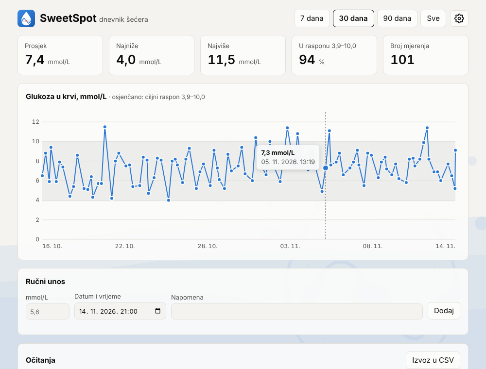

**Teme:** Svijetla, Pijesak, Tamna, Ponoć i Matrix, a zadano se prati tema sustava.

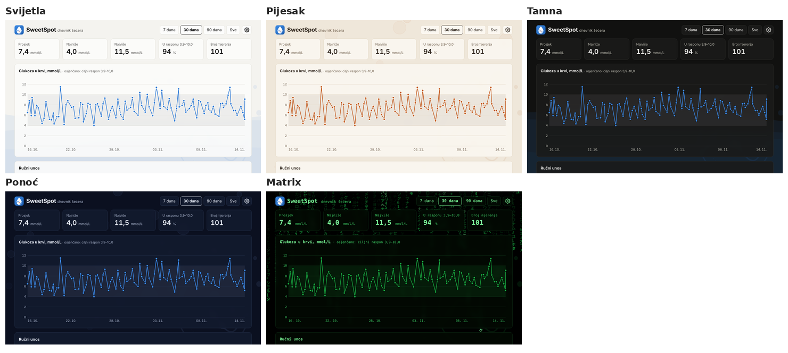

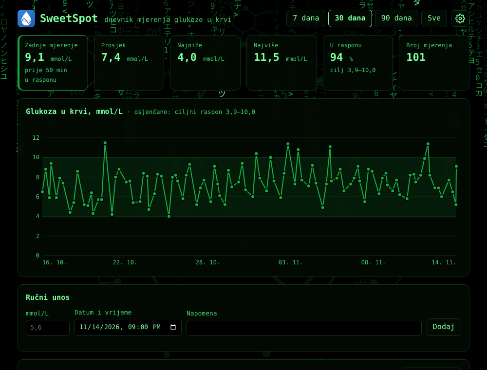

**Postavke** (ikona zupčanika gore desno):

- **ciljni raspon** – donja i gornja granica u mmol/L; sprema se na poslužitelj i vrijedi na svim uređajima
- **token za agente** – prikaz i kopiranje tokena koji se upisuje u Windows i Android agenta
- **tema** i **animirana pozadina** (valovi, mjehurići, kiša znakova ili bez animacije)
- **stilizirana slika u pozadini** – kap, molekula glukoze i krivulja s ciljnim pojasom
- **prozirnost kartica** – klizač od 0 do 70 %, koliko se pozadina vidi kroz kartice

Tema, pozadina i prozirnost pamte se na svakom uređaju posebno. Ako je u sustavu uključeno smanjeno kretanje,
pozadina se ne miče.

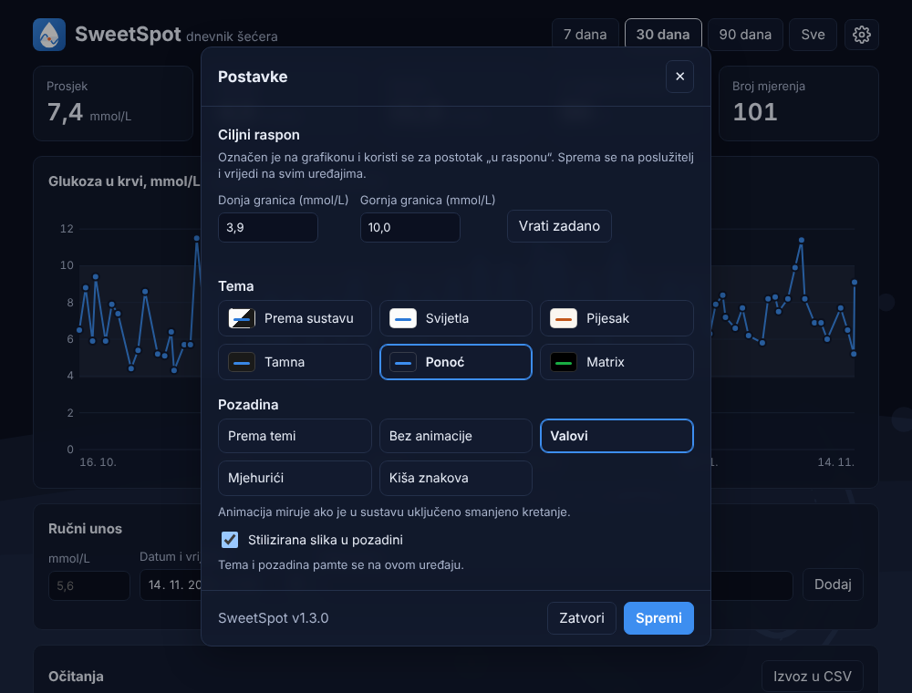

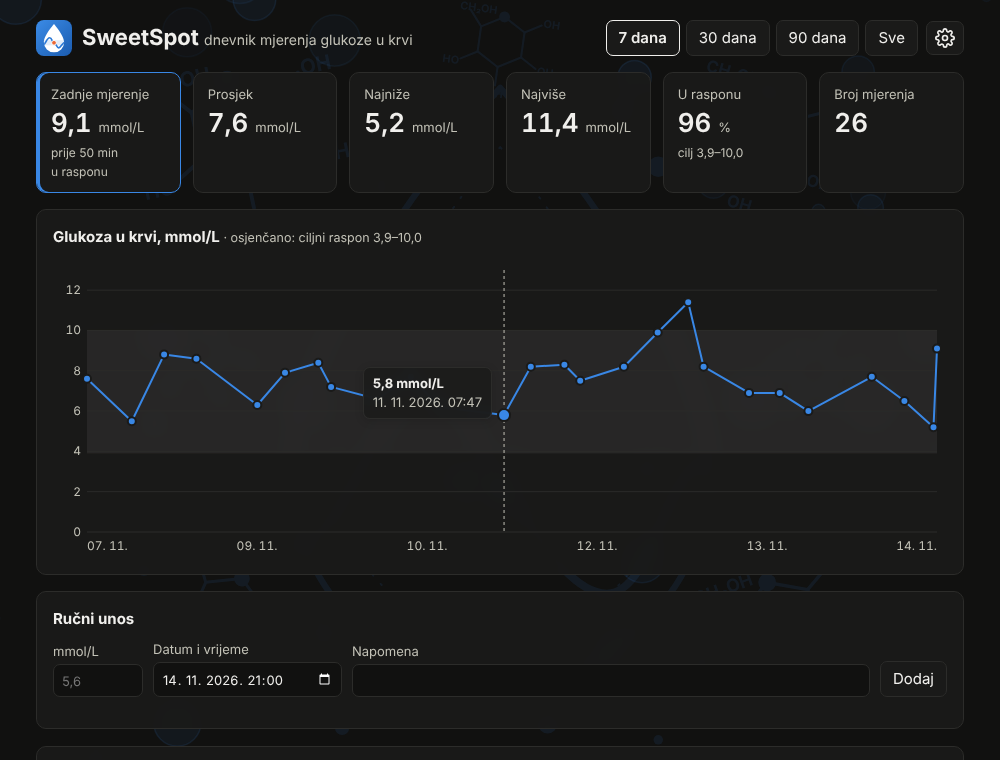

Na mobitelu:

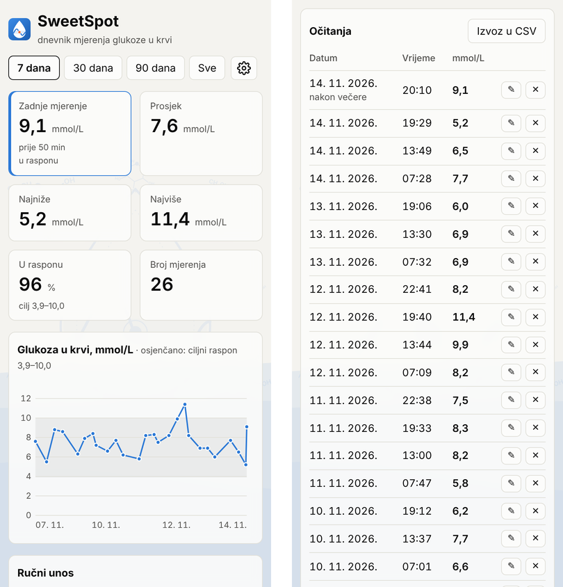

### Agent za Windows

| Postavke | Čarobnjak: priprema |
|---|---|
| 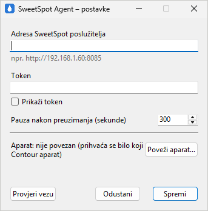 | 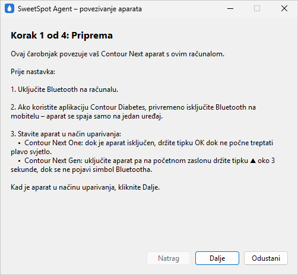 |
| **Čarobnjak: traženje aparata** | **Čarobnjak: gotovo** |
| 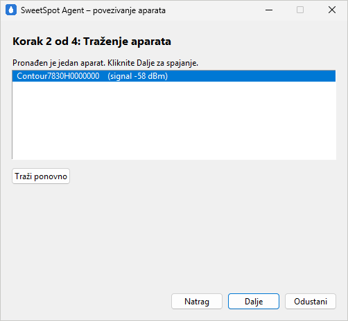 | 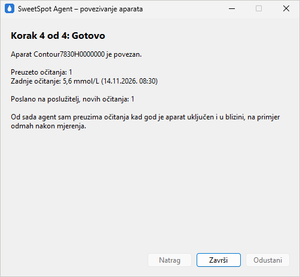 |

Ako spajanje ne uspije, čarobnjak prikaže razlog i što provjeriti:

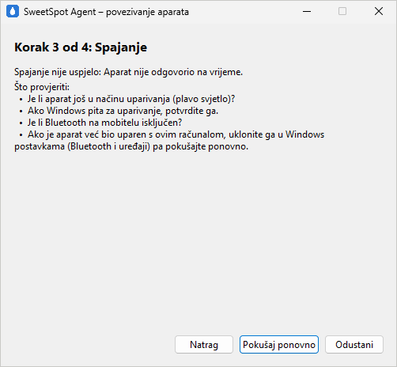

### Agent za Android

| Početni zaslon | Postavke | Tamna tema |
|---|---|---|
| 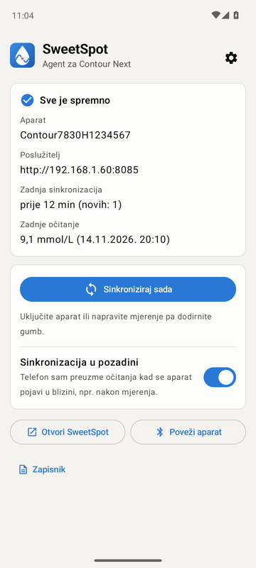 | 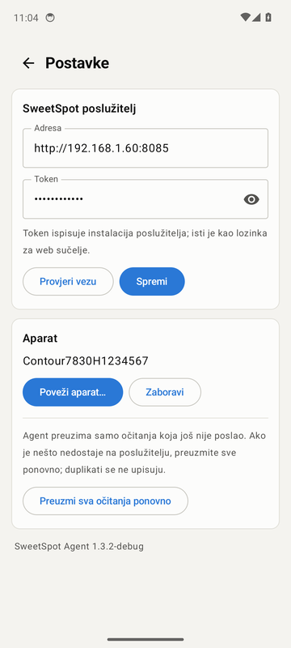 | 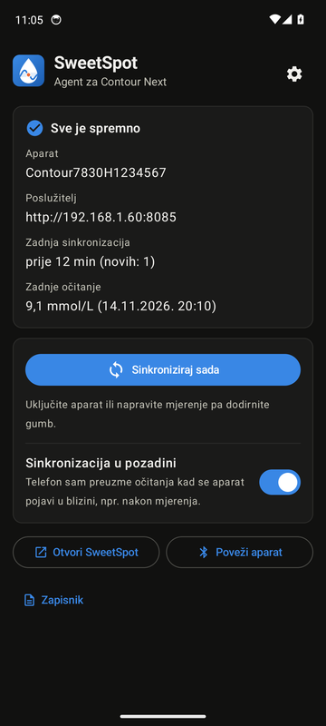 |

| Čarobnjak: priprema | Traženje aparata | Neuspjelo spajanje | Gotovo |
|---|---|---|---|
| 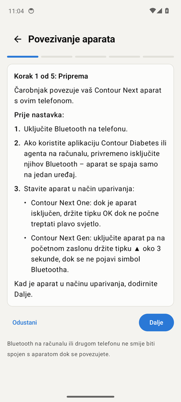 | 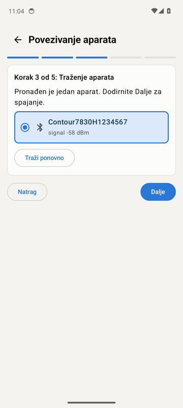 | 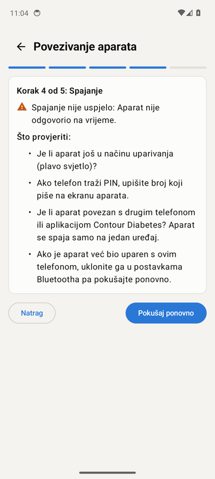 | 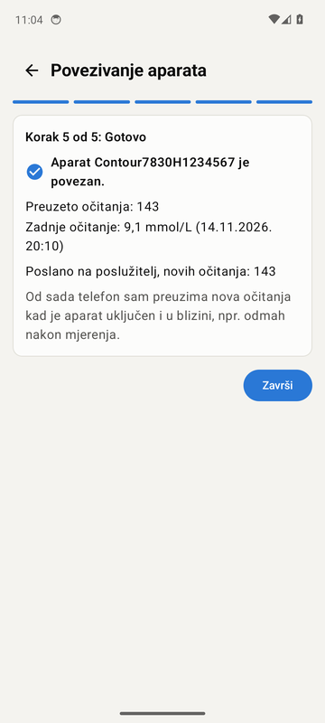 |

Snimke su napravljene s probnim podacima.

## 1. Instalacija web aplikacije

### Proxmox

Na Proxmox hostu, kao root:

```sh
wget -O sweetspot_install.sh https://github.com/moordrak/SweetSpot/releases/latest/download/sweetspot_install.sh
bash sweetspot_install.sh
```

Skripta stvara neprivilegirani Debian LXC kontejner (1 jezgra, 512 MB RAM-a, 4 GB diska, DHCP na `vmbr0`),
instalira Docker, pokreće SweetSpot i na kraju ispisuje adresu sučelja i generirani token.

Na početku pita dvije stvari:

- **spremište** za disk kontejnera – nudi popis aktivnih spremišta sa slobodnim prostorom,
- **root lozinku** kontejnera – prazan unos znači kontejner bez lozinke (ulaz samo s hosta: `pct enter CTID`).

Za instalaciju bez pitanja zadajte `STORAGE=...` i `ROOT_PASSWORD=...`.

Postavke se mijenjaju varijablama okoline:

```sh
CTID=150 STORAGE=local-zfs IP=192.168.1.60/24 GW=192.168.1.1 PORT=8085 bash sweetspot_install.sh
```

### Postojeći Docker host

```sh
bash sweetspot_install.sh --local
```

Postavlja SweetSpot u `/opt/sweetspot`. Ponovno pokretanje nadograđuje sliku, a token i baza ostaju.

### Ručno, s Docker Composeom

```sh
git clone https://github.com/moordrak/SweetSpot.git && cd SweetSpot
cp .env.example .env       # upišite vlastiti API_TOKEN
docker compose up -d
```

Sučelje je na `http://IP-ADRESA:8085`. Preglednik traži prijavu: korisničko ime je proizvoljno,
lozinka je `API_TOKEN`. Baza je u mapi `./data` – nju uključite u backup.

Aplikacija sama ne radi HTTPS. Izvan kućne mreže izlažite je samo preko reverse proxyja s TLS-om
(dovoljan je običan `proxy_pass http://IP:8085;`).

## 2. Agent na PC-u

### Windows

Preuzmite `SweetSpot-Agent-Setup-x.y.z.exe` iz [zadnjeg izdanja](https://github.com/moordrak/SweetSpot/releases/latest)
i pokrenite ga. Instalacija ne traži administratorska prava i nudi pokretanje pri prijavi u Windows.

Agent radi kao ikona pored sata (system tray). Pri prvom pokretanju otvara **Postavke**, gdje upisujete
adresu poslužitelja i token; gumb **Provjeri vezu** odmah pokazuje jesu li ispravni.

Nakon spremanja postavki otvara se **čarobnjak za povezivanje aparata**, koji vodi kroz četiri koraka:

1. **Priprema** – što uključiti i kako staviti aparat u način uparivanja.
2. **Traženje aparata** – popis Contour aparata u blizini s jačinom signala.
3. **Spajanje** – uparivanje i probno preuzimanje očitanja; ako ne uspije, nudi savjete i ponovni pokušaj.
4. **Gotovo** – broj preuzetih očitanja i zadnje očitanje.

Povezani aparat se pamti, pa agent ubuduće traži samo njega. Čarobnjak se može ponovno pokrenuti
iz izbornika (**Poveži aparat…**).

Desni klik na ikonu:

- stanje agenta i vrijeme zadnje sinkronizacije
- **Otvori SweetSpot** – web sučelje u pregledniku (i dvoklik na ikonu)
- **Sinkroniziraj sada** – odmah traži aparat
- **Postavke…** – adresa, token, pauza nakon preuzimanja
- **Poveži aparat…** – čarobnjak za povezivanje aparata
- **Pokreni s Windowsima** – uključuje i isključuje automatsko pokretanje
- **Zapisnik** – otvara `agent.log`
- **Izlaz**

Ikona je plava kad sve radi, narančasta kad nešto ne valja (Bluetooth isključen, poslužitelj nedostupan)
i siva dok agent nije podešen. Postavke, zapisnik i neposlana očitanja su u `%APPDATA%\SweetSpot`.

Windows SmartScreen može upozoriti da je izdavač nepoznat jer instalacija nije digitalno potpisana:
**More info → Run anyway**.

### Android

Preuzmite `SweetSpot-Android-x.y.z.apk` iz [zadnjeg izdanja](https://github.com/moordrak/SweetSpot/releases/latest)
na telefon i otvorite ga. Android će tražiti dopuštenje za instalaciju iz tog izvora (preglednik ili upravitelj
datoteka) – dopustite ga. Potreban je Android 12 ili noviji.

Pri prvom pokretanju aplikacija otvara **Postavke** (adresa poslužitelja i token, uz gumb **Provjeri vezu**), a
zatim **čarobnjak za povezivanje aparata**: priprema, dozvole (uređaji u blizini i obavijesti), traženje aparata,
uparivanje s preuzimanjem očitanja i završni pregled. Ako telefon pri uparivanju traži PIN, upišite broj s ekrana aparata.

Na početnom zaslonu su stanje (aparat, poslužitelj, zadnja sinkronizacija i zadnje očitanje), gumb
**Sinkroniziraj sada**, prekidač **Sinkronizacija u pozadini**, **Otvori SweetSpot** i **Zapisnik**.

**Sinkronizacija u pozadini:** telefon u pozadini osluškuje povezani aparat (štedljivo traženje koje vodi sustav,
aplikacija ne mora biti otvorena). Kad se aparat pojavi u blizini, npr. nakon mjerenja, agent preuzme samo nova
očitanja i pošalje ih. Ako poslužitelj nije dostupan (npr. niste u kućnoj mreži), očitanja čekaju na telefonu i
šalju se kasnije, svakih 15 minuta dok ne prođu. Nakon ponovnog pokretanja telefona sve se samo uključuje.

Aparat se spaja samo na jedan uređaj. Ako koristite i Windows agenta, onaj koji prvi uhvati aparat preuzet će
očitanja; poslužitelj odbacuje duplikate, pa se ništa ne upisuje dvaput.

### Linux i macOS (Python)

Potreban je Python 3.9+ i Bluetooth na računalu. Preuzmite `sweetspot-agent.zip` iz
[zadnjeg izdanja](https://github.com/moordrak/SweetSpot/releases/latest) i raspakirajte ga.

```sh
pip install bleak
```

U `agent/config.ini` upišite adresu aplikacije i token, zatim:

```sh
python sweetspot_agent.py --test    # provjera veze s poslužiteljem
python sweetspot_agent.py --once    # jedno preuzimanje s aparata
python sweetspot_agent.py           # radi stalno u pozadini
```

Za automatsko pokretanje na Linuxu: systemd korisnički servis s
`ExecStart=python3 /putanja/agent/sweetspot_agent.py`.

### Kako agent radi

Agent čeka da se aparat pojavi (nakon mjerenja ili kad ga uključite), preuzme sva očitanja i pošalje ih.
Poslužitelj odbacuje duplikate. Ako poslužitelj nije dostupan, očitanja se čuvaju i šalju kasnije.

### Bluetooth napomene

- Radi s modelima koji imaju Bluetooth (Contour Next One, Contour Next Gen).
- Aparat se spaja samo na jedan uređaj: dok agent preuzima, isključite Bluetooth na mobitelu
  ako koristite aplikaciju Contour Diabetes.
- Pri prvom spajanju aparat može tražiti uparivanje – stavite ga u način uparivanja
  prema uputama aparata i potvrdite na računalu.

## API

| Metoda | Putanja | Opis |
|---|---|---|
| GET | `/api/readings` | sva očitanja |
| POST | `/api/readings` | `{"readings":[{"time":"2026-11-14T08:30:00","mmol":5.6,"source":"aparat"}]}` |
| PATCH | `/api/readings/<id>` | `{"note":"nakon večere"}` – izmjena napomene |
| DELETE | `/api/readings/<id>` | brisanje |
| GET | `/api/export.csv` | izvoz |
| GET | `/api/token` | token za agente (samo uz prijavu) |
| GET | `/api/settings` | postavke (`low`, `high`) i verzija programa |
| PUT | `/api/settings` | `{"low":3.9,"high":10.0}` – novi ciljni raspon |
| GET | `/api/health` | provjera rada (bez prijave) |

Autorizacija: zaglavlje `Authorization: Bearer <API_TOKEN>`.

## Ključ za potpisivanje Android aplikacije

Android dopušta nadogradnju samo ako je nova verzija potpisana istim ključem. Ključ se čuva u tajnama repozitorija
(**Settings → Secrets and variables → Actions → New repository secret**):

| Tajna | Sadržaj |
|---|---|
| `ANDROID_KEYSTORE_BASE64` | datoteka ključa (`.jks`) kodirana u base64 |
| `ANDROID_KEYSTORE_PASSWORD` | lozinka ključa |
| `ANDROID_KEY_ALIAS` | `sweetspot` |

Bez tih tajni gradi se samo razvojna inačica, a izdanje nema APK. Ključ i lozinku čuvajte i izvan GitHuba:
bez njih se buduće verzije ne mogu instalirati preko postojeće.

## Izdavanje nove verzije

Promijenite broj u datoteci `VERSION` i pošaljite promjenu na granu `main`
(ili pošaljite oznaku oblika `v1.1.0`). GitHub Actions tada gradi Docker sliku,
objavljuje je na `ghcr.io`, gradi Windows instalaciju agenta i stvara release sa svim datotekama.

## Napomena

SweetSpot je osobni dnevnik, a ne medicinski uređaj. Zadani ciljni raspon (3,9–10,0 mmol/L)
mijenja se u postavkama web sučelja; dogovorite ga sa svojim liječnikom.
